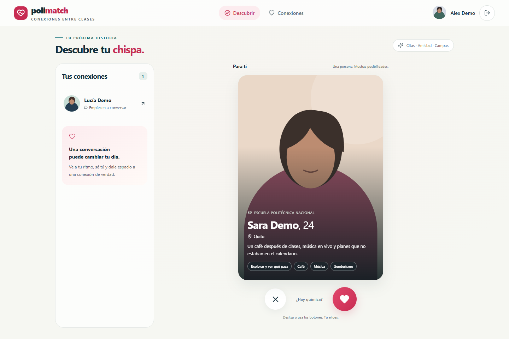
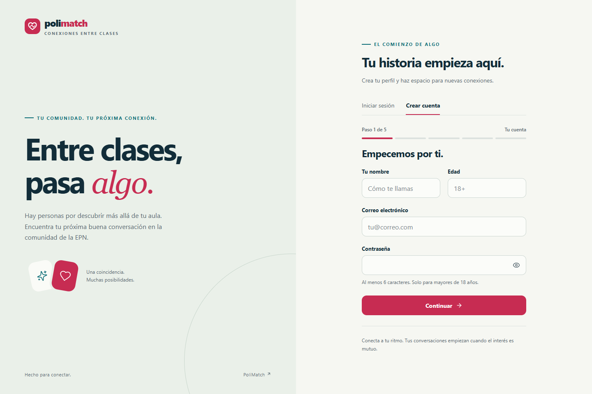
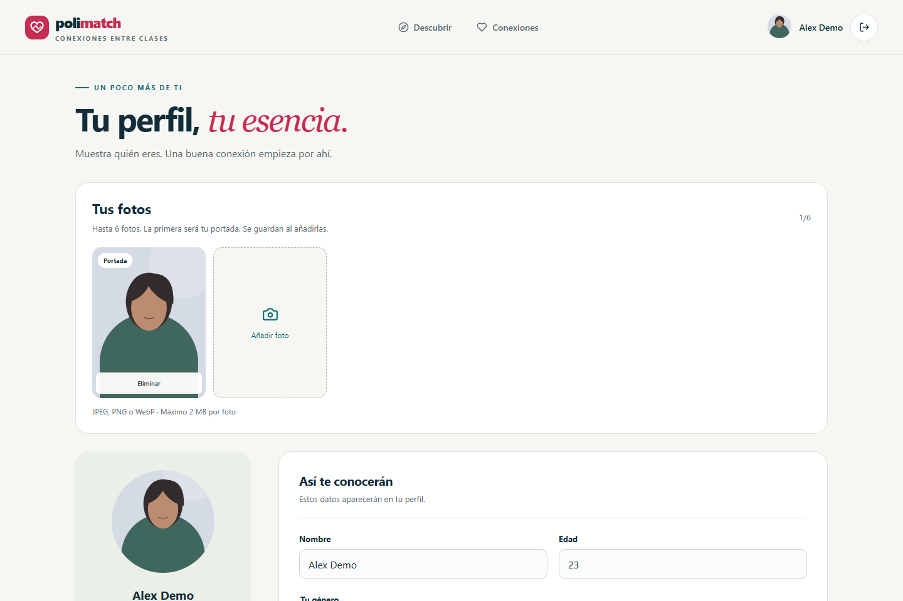
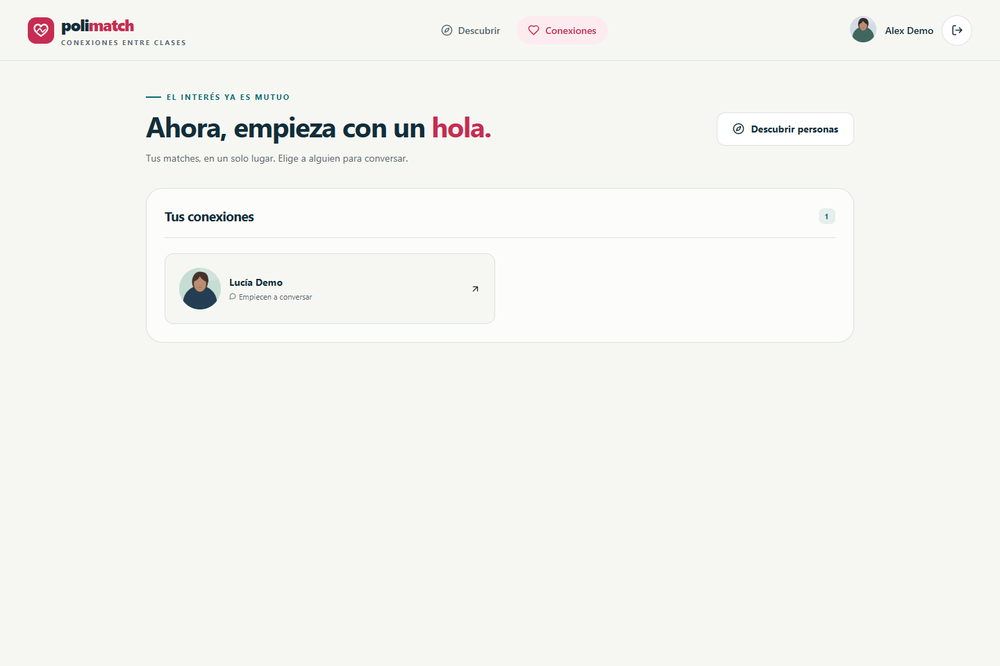
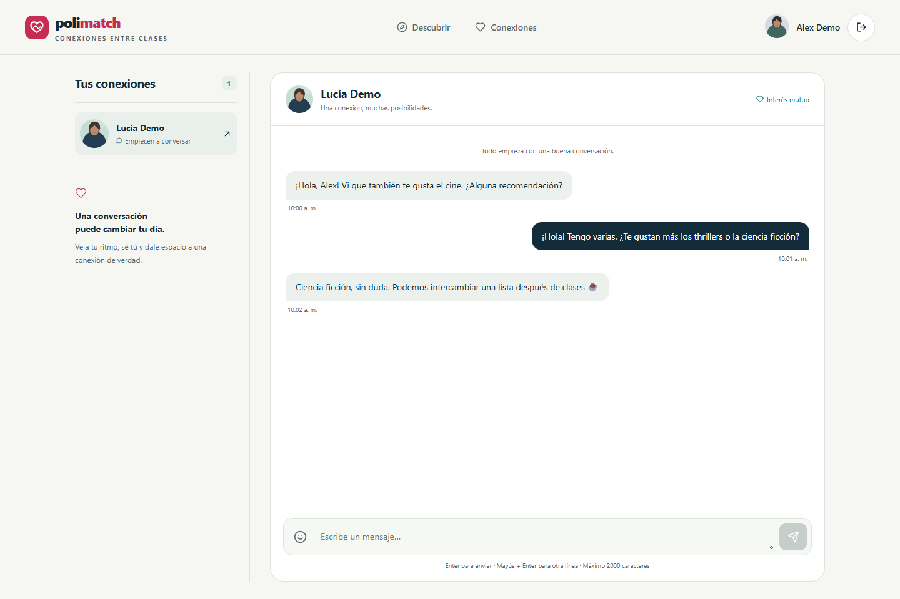
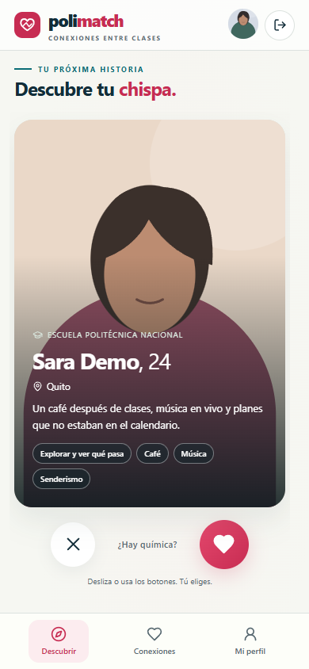
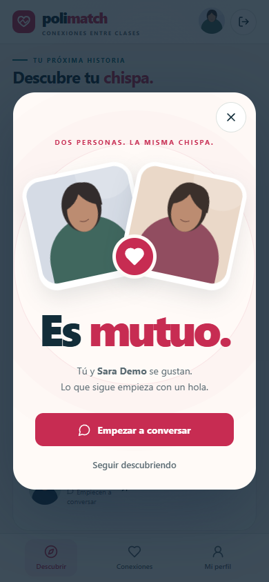
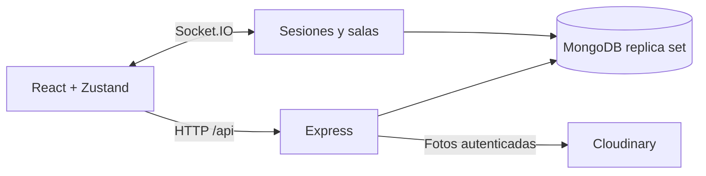

# PoliMatch EPN

**Una conexión empieza con un interés mutuo.**

Aplicación full stack del ecosistema MERN para descubrir personas de la comunidad universitaria, conectar por citas, amistad o campus y conversar en tiempo real.

**React · Express · MongoDB · Socket.IO · Zustand · Playwright**

[Funcionalidades](#funcionalidades) · [Arquitectura](#arquitectura) · [Ejecutar localmente](#preparación-local) · [Pruebas](#comprobaciones) · [Despliegue y Docker](docs/despliegue.md)

> Proyecto de portafolio en evolución. Demo pública pendiente. Las capturas muestran la aplicación real con datos ficticios y retratos ilustrados, sin cuentas ni conversaciones personales.



<details>
<summary><strong>Ver registro, conexiones, chat y experiencia móvil</strong></summary>

### Registro y perfil

| Registro guiado                                                | Perfil y galería                                                     |
| -------------------------------------------------------------- | -------------------------------------------------------------------- |
|  |  |

### Conexiones y conversación

| Matches en una vista propia                                      | Chat en tiempo real                                                         |
| ---------------------------------------------------------------- | --------------------------------------------------------------------------- |
|  |  |

### Experiencia móvil

<p align="center">
  
  
</p>

[Cómo regenerar las capturas](docs/screenshots/README.md).

</details>

## Decisiones de ingeniería

- **Sesiones revocables:** cookie HttpOnly y sesiones persistidas; cerrar sesión también invalida sus conexiones de socket.
- **Privacidad por contrato:** DTO públicos y propios separados; una conexión mutua autoriza el acceso al chat.
- **Matching atómico:** transacciones MongoDB para resolver likes simultáneos sin duplicar matches.
- **Estado resistente a carreras:** respuestas de una sesión o conversación anterior no sobrescriben la actual.
- **Movimiento conectado al estado real:** gestos y botones comparten el ciclo de decisión; una petición fallida devuelve la tarjeta.
- **Validación en capas:** pruebas de API, stores, navegador y un recorrido real contra MongoDB temporal.

## Funcionalidades

- Registro e inicio de sesión mediante cookie HttpOnly, sesiones revocables y cierre de sesión.
- Registro por pasos; perfil con nombre, edad, biografía, preferencias, intención, hasta cinco intereses, ciudad y universidad.
- Galería de hasta seis fotos, portada editable y eliminación del perfil; subidas individuales de hasta 2 MB.
- Descubrimiento por preferencias recíprocas, likes, descartes y matches.
- Chat entre conexiones mutuas, entrega en tiempo real y carga de mensajes anteriores.
- Interfaz en español, adaptable a móvil y escritorio, controles por teclado y movimiento reducido.
- Tarjetas con arrastre interrumpible, salida coordinada con la API y recuperación ante errores; celebración de match con acceso al chat.
- Navegación diferenciada: `/` para descubrir personas, `/connections` para ver los matches y abrir conversaciones. El enlace antiguo `/#conexiones` redirige a la nueva vista.

La intención permite expresar citas, amistad o conexiones del campus y se muestra en el perfil; no cambia las reglas de matching. No están implementados pagos, premium, calendario, verificación institucional, recuperación de contraseña, bloqueo/reporte ni filtros por intención/intereses.

## Arquitectura

| Carpeta                                  | Responsabilidad                                                                 |
| ---------------------------------------- | ------------------------------------------------------------------------------- |
| `api/app.js`                             | App Express, rutas, origen, límites y errores; importable sin arrancar servidor |
| `api/server.js`                          | Validación de configuración, conexión a MongoDB y ciclo de vida HTTP/socket     |
| `api/controllers`, `middleware`, `utils` | Casos de uso, autorización, validación y DTO públicos/propios                   |
| `api/models`                             | User, Message y Session                                                         |
| `api/socket`                             | Autenticación por cookie, salas de usuario/sesión y expiración                  |
| `client/src/pages`, `components`         | React, navegación y sistema visual CSS                                          |
| `client/src/store`                       | Zustand con aislamiento por sesión/conversación                                 |
| `tests/api`                              | Integración HTTP/Socket.IO contra MongoDB efímero                               |
| `tests/e2e`                              | Navegador y axe con datos ficticios; sin base remota                            |
| `tests/fullstack`                        | Recorrido real navegador → API → MongoDB temporal y Socket.IO                   |

React 18 y Vite 6 en el cliente; Express 4, Mongoose 8 y Socket.IO 4 en el servidor. Zustand 5 administra el estado por sesión y conversación. Las páginas y el selector de emojis se cargan cuando se necesitan; el sistema visual usa CSS propio y las animaciones respetan movimiento reducido.



## Preparación local

Usa **Node.js 22.12+ de la rama 22, Node 24 o una versión compatible posterior**, con npm. Las versiones exactas de dependencias están fijadas por ambos lockfiles.

```sh
npm ci
npm ci --prefix client
```

Copia `.env.example` a `.env` solo si no tienes ya configuración. Completa `MONGO_URI`, `JWT_SECRET` y `CLIENT_URL`; las credenciales Cloudinary son necesarias para subir fotografías. No publiques `.env`.

**MongoDB requiere replica set** para que dos likes simultáneos creen un match de forma atómica. Atlas lo proporciona. Una instalación local debe iniciarse con `--replSet rs0` e inicializar su réplica; una instancia standalone se rechaza al arrancar. No ejecutes procedimientos de inicialización sobre una base existente sin revisar su configuración.

En dos terminales:

```sh
npm run dev
npm run dev --prefix client -- --host localhost --port 5173 --strictPort
```

Abre [PoliMatch local](http://localhost:5173). El cliente usa `/api` y `/socket.io` del mismo origen; Vite los envía a `http://localhost:5000`. Para cambiar ese destino, usa `client/.env.local` con `API_PROXY_TARGET`. El origen del navegador debe coincidir exactamente con `CLIENT_URL` (localhost y 127.0.0.1 son distintos).

## Comprobaciones

```sh
npm run check
npm run test:e2e
npm run test:integration
npm audit
npm audit --prefix client
```

`check` ejecuta tests API, tests del estado cliente, lint y build, y se detiene ante el primer fallo. También se pueden ejecutar por separado `npm test`, `npm run test:client`, `npm run lint` y `npm run build`.

La suite API crea una réplica MongoDB efímera y cuentas ficticias, sin cargar `.env`. La primera ejecución descarga el binario de MongoDB y puede tardar; requiere acceso de red al proveedor del binario. La suite de navegador usa Edge instalado en Windows o Chromium de Playwright en otros sistemas (`npx playwright install chromium`). Comprueba escritorio, 390px y 320px, interacción, errores y accesibilidad automática. Sus capturas están en `tests/e2e/artifacts/results` y están ignoradas por Git.

`test:integration` arranca frontend y API aislados con MongoDB temporal: verifica dos cuentas ficticias, match recíproco, mensajes por socket, persistencia y revocación de sesión. No carga las credenciales de `.env` ni usa la base configurada para desarrollo.

El workflow de GitHub Actions está configurado para ejecutar estas comprobaciones; aún no se ha ejecutado en GitHub. Las pruebas automatizadas usan datos ficticios y servicios aislados; la subida a Cloudinary debe verificarse con la configuración del entorno de despliegue.

## Datos de demostración locales

El seed conserva los perfiles existentes y crea únicamente los ficticios que falten. Requiere `SEED_URI` apuntando a MongoDB en localhost con base `polimatch_seed` o `polimatch_test`, y `SEED_CONFIRM=polimatch-local-demo`. Ejecuta `node api/seeds/user.js` únicamente tras configurar esas variables. Rechaza servidores remotos y `NODE_ENV=production`; no utiliza `MONGO_URI` ni carga `.env`.

## Contratos y límites

- Cookie JWT de siete días, HttpOnly, SameSite Strict y Secure en producción. La identidad de socket procede de esa cookie.
- La colección Session permite revocar la sesión al cerrar, incluso entre reinicios.
- Solo una conexión mutua permite leer o enviar mensajes; el cliente no decide la identidad del emisor.
- Perfil: nombre hasta 80 caracteres, bio hasta 500, edad entera 18–120, foto hasta 2 MB y JSON hasta 3 MB.
- Galería: `POST /api/users/photos` sube una imagen autenticada; `PUT /api/users/update` con `photos` reordena o retira URLs propias ya guardadas. La capacidad de seis fotos se comprueba atómicamente. Retirar una foto del perfil no borra el archivo de Cloudinary; la gestión de retención del almacenamiento requiere un procedimiento separado.
- Mensajes hasta 2000 caracteres, páginas de 50 por defecto y máximo 100; cursor `before` y respuesta `hasMore/nextCursor`.
- Descubrimiento entrega lotes acotados; el cliente pide el siguiente al terminar.
- Errores API JSON consistentes, sin hashes ni credenciales en respuestas.
- `GET /api/health` indica disponibilidad de la base; no muestra secretos.


## Docker y demo pública

Docker es opcional: el desarrollo normal sigue funcionando con Node. Se incluye una imagen multietapa que compila React y ejecuta Express como usuario sin privilegios, sin incorporar archivos de entorno. La compilación del contenedor está pendiente de verificación en un entorno con Docker; GitHub Actions incluye el job correspondiente.

Para una demo se recomienda un servicio Node/Docker en un solo origen, Atlas y Cloudinary. Consulta [alternativas gratuitas, límites y guía de Docker](docs/despliegue.md). Publicar el repositorio no exige contratar ni desplegar servicios.

## Despliegue

Compila con `npm run build`, configura `NODE_ENV=production`, HTTPS y `CLIENT_URL` con el origen público y ejecuta `npm start`. Express sirve `client/dist`. El diseño de cookies supone frontend y API en el mismo sitio; el despliegue del mismo origen es el camino más sencillo.

Antes de publicar:

1. Revisar credenciales, permisos de Atlas/Cloudinary y reglas de acceso de red.
2. Preparar y verificar índices de User (email único), Message (consulta de conversación) y Session (usuario y expiración TTL). En producción `autoIndex` está desactivado para no cambiar índices automáticamente. Ejecutar su creación con un procedimiento autorizado y respaldo.
3. Verificar que el índice único de correo esté creado antes de abrir el registro.
4. Configurar `TRUST_PROXY` solo si hay proxies conocidos y verificar que no existe un camino directo que permita eludirlos. El limitador de autenticación es local al proceso; varias instancias requieren almacenamiento compartido.
5. Realizar prueba de aceptación con cuentas de prueba autorizadas y subida real de foto. No se ha efectuado un despliegue ni una migración remota.

## Documentación

- [Despliegue y Docker](docs/despliegue.md).
- [Capturas reproducibles](docs/screenshots/README.md).

## Autor

[Erick Eduardo Espinoza Tipantiza (Belki)](https://github.com/ErickEduardoEspinozaTipantiza)
